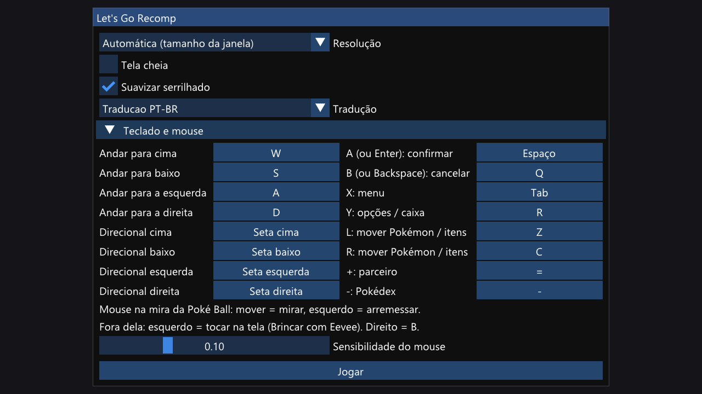

# Let's Go Recomp

Port nativo para Windows do **Pokémon: Let's Go, Eevee!** (Nintendo Switch, v1.0.0), feito por **recompilação
estática**: o código ARM64 do jogo é traduzido para C e compilado como um programa do Windows. Um runtime substitui o
sistema do Switch (kernel, serviços, gráficos NVN → Vulkan, áudio, controles, tela de toque). **Não é um emulador.**

*In English: a native Windows port of Pokémon: Let's Go, Eevee! (Switch v1.0.0) by static recompilation, built on the
[LAS Recomp](https://github.com/peiikai/LASRecomp) runtime. See [the English summary](#in-english) at the end.*

> [!NOTE]
> **Nenhum arquivo do jogo está incluído.** Você precisa da sua própria cópia, obtida legalmente, dos arquivos
> extraídos do *Pokémon: Let's Go, Eevee!* **v1.0.0**. Este repositório não fornece nem ensina a obter esses arquivos
> (nem chaves). Nada do jogo (código, imagens, textos, músicas, fontes) faz parte do repositório.

## Estado

Jogável: abertura, introdução, exploração, capturas, batalhas, menus, salvar e carregar, a **30 fps estáveis** (a
taxa original do jogo) em resoluções de 720p a 4K. Detalhes em [docs/PROGRESSO.md](docs/PROGRESSO.md).

### Problemas conhecidos
- Só a versão **Eevee v1.0.0** e só **Windows** (os caminhos de macOS e Linux vieram do LAS Recomp, mas não foram
  testados aqui).
- **60 fps não é possível** por enquanto: a lógica do jogo avança um passo por quadro (dobrar os quadros dobra a
  velocidade). A pesquisa está em [docs/PESQUISA-60FPS.md](docs/PESQUISA-60FPS.md).
- Na **primeira vez** que um objeto aparece no seu PC, ele pode surgir 1 ou 2 quadros atrasado, enquanto o driver
  prepara o shader. Da segunda vez em diante o cache resolve.
- O giroscópio de controles com sensor (DualSense, Pro Controller) não é usado: a mira é pelo analógico ou pelo mouse.
- Recursos online (GO Park, trocas, batalhas online, Poké Ball Plus) ficam desligados.
- Ainda há restos da camada do Zelda no código do runtime (stubs do randomizer e opções antigas sem uso).

## Recursos
- **Nativo:** o código do jogo roda compilado, não emulado.
- **Imagem:**
  - resolução interna de 720p a 4K, inclusive acima da tela (supersampling, com redução de boa qualidade);
  - SMAA contra serrilhado e filtro anisotrópico 16×;
  - qualquer tamanho e proporção de janela, e tela cheia.
- **Sem travadas de shader:** shaders traduzidos em paralelo, cache de SPIR-V e de pipelines em disco, e os objetos
  esperam o shader ficar pronto em vez de sumirem.
- **Launcher simples:** resolução, tela cheia, antisserrilhado, tradução e o mapeamento do teclado.
- **Controles:**
  - **controle:** qualquer um reconhecido pelo SDL, no layout do modo portátil;
  - **teclado:** todas as teclas podem ser trocadas no launcher;
  - **mouse:** mira a Poké Ball como o giroscópio do Switch e serve de dedo na tela de toque ("Brincar com Eevee":
    carinho e frutas);
  - **só com controle:** a tela de toque também funciona, com o analógico direito movendo um dedo e o ZR tocando.
- **Traduções e mods:** pasta `mods/` no formato do Atmosphere (LayeredFS), escolhida no launcher. Testado com a
  tradução PT-BR de fãs do grupo Pokémon Switch Brasil.

## Como jogar

O passo a passo completo, do zero até o jogo aberto, está em **[docs/COMPILAR-WINDOWS.md](docs/COMPILAR-WINDOWS.md)**.
Em resumo:

1. `powershell -ExecutionPolicy Bypass -File tools\setup_windows.ps1` (uma vez: MSYS2, clang, SDL3, FFmpeg, Vulkan,
   Python).
2. Coloque os **seus** arquivos do jogo em `extracted/` (`exefs/` e `romfs.bin`).
3. No Git Bash com o MSYS2 no PATH: `make gen`, `make -j20` e `make jogo`.
4. Dê dois cliques em `jogar.bat`.

Requisitos: Windows 10/11 x64, CPU com AVX2, GPU com Vulkan 1.3, uns 10 GB livres.

### Controles

| Ação | Teclado | Mouse | Controle |
|---|---|---|---|
| Andar / mirar | WASD | — | analógico esquerdo |
| A: confirmar, falar, arremessar | Espaço ou Enter | esquerdo (na mira) | A |
| B: cancelar | Q ou Backspace | direito | B |
| X: menu | Tab | — | X |
| Y: opções, caixa | R | — | Y |
| L / R | Z / C | — | L / R |
| + parceiro / − Pokédex | `=` / `-` | — | + / − |
| Mirar a Poké Ball | WASD | movimento (depois do "Get ready") | analógico esquerdo |
| Tela de toque (Brincar com Eevee) | — | esquerdo segurado | analógico direito + ZR |
| Fechar o jogo | Esc | — | − e + juntos |

### Traduções

Coloque a tradução em `mods/<nome>/`: o conteúdo de `atmosphere/contents/0100187003A36000/romfs` (ou o pacote
inteiro, a pasta do Eevee é achada sozinha). Ela aparece em "Tradução" no launcher. Detalhes em
[docs/PROGRESSO.md](docs/PROGRESSO.md).

## Documentação
- [docs/COMPILAR-WINDOWS.md](docs/COMPILAR-WINDOWS.md): passo a passo para compilar e jogar
- [docs/PROGRESSO.md](docs/PROGRESSO.md): o que funciona e o que falta
- [docs/HISTORICO.md](docs/HISTORICO.md): cada problema encontrado, a causa e a correção
- [docs/DEPURACAO.md](docs/DEPURACAO.md): ferramentas e variáveis de diagnóstico
- [docs/DIAGNOSTICO.md](docs/DIAGNOSTICO.md): módulos do jogo e cobertura do tradutor
- [docs/MODO-BATALHA.md](docs/MODO-BATALHA.md): modo de batalha contra Pokémon selvagens (em andamento)
- [docs/PLANO-3D.md](docs/PLANO-3D.md), [docs/PESQUISA-60FPS.md](docs/PESQUISA-60FPS.md),
  [docs/ANALISE-LASRecomp.md](docs/ANALISE-LASRecomp.md): investigações anteriores
- [CONTRIBUTING.md](CONTRIBUTING.md): como reportar problemas e contribuir

## Créditos
- **[LAS Recomp](https://github.com/peiikai/LASRecomp)** por Peiikai: o recompilador e o runtime em que este projeto
  se baseia (licença MIT, [LICENSE-LASRecomp](LICENSE-LASRecomp)).
- **Pokémon Switch Brasil** (Derek e equipe): a tradução PT-BR de fãs com que o suporte a mods foi testado. Ela não
  está incluída; é distribuída pelo próprio grupo.
- **Bibliotecas e ferramentas:**
  - [SDL 3](https://libsdl.org) (zlib): janela, entrada, áudio;
  - [FFmpeg](https://ffmpeg.org) (LGPL/GPL, ligado dinamicamente): vídeos;
  - [Dear ImGui](https://github.com/ocornut/imgui) (MIT): launcher e menu;
  - [Vulkan Memory Allocator](https://github.com/GPUOpen-LibrariesAndSDKs/VulkanMemoryAllocator) (MIT);
  - [shaderc](https://github.com/google/shaderc) (Apache 2.0);
  - [SMAA](https://github.com/iryoku/smaa) (MIT, `third_party/smaa/LICENSE.txt`);
  - [AMD FSR 1](https://github.com/GPUOpen-Effects/FidelityFX-FSR) (MIT);
  - a fonte [Baloo 2](https://github.com/EkType/Baloo2) (SIL OFL 1.1, `third_party/fonts/Baloo2/OFL.txt`);
  - [Capstone](https://www.capstone-engine.org), [Unicorn](https://www.unicorn-engine.org) e
    [python-lz4](https://github.com/python-lz4/python-lz4) no gerador de código.
- A documentação da comunidade homebrew do Switch ([Switchbrew](https://switchbrew.org)) e do
  [envytools](https://github.com/envytools/envytools) (GPUs NVIDIA).

## Aviso legal
Este é um projeto de fã, sem afiliação, apoio ou patrocínio da Nintendo, The Pokémon Company, Game Freak ou Creatures.
*Pokémon* e *Pokémon: Let's Go, Eevee!* são marcas dos seus donos. Nenhum arquivo, código, imagem, texto, música ou
fonte do jogo está incluído. Para jogar, você precisa fornecer a sua própria cópia, obtida legalmente.

## Licença
O código deste repositório (o recompilador, o runtime e as ferramentas) está sob a [licença MIT](LICENSE), assim como
o LAS Recomp em que se baseia. Os componentes de terceiros mantêm as suas licenças (listadas em Créditos). A licença
cobre só este código e não dá nenhum direito sobre o jogo.

## In English

**Let's Go Recomp** is a static recompilation of *Pokémon: Let's Go, Eevee!* (Nintendo Switch, v1.0.0) into a native
Windows application, built on the [LAS Recomp](https://github.com/peiikai/LASRecomp) runtime. **No game files are included**: you
need your own legally obtained copy of the extracted v1.0.0 game files; this repository does not explain how to get
them.

It runs at a stable 30 fps (the game's own rate) from 720p to 4K, with SMAA, 16x anisotropic filtering, a
simple launcher, keyboard / mouse / controller support (the mouse aims Poké Balls like the Switch's gyro and acts as
a finger on the touch screen), and Atmosphere-style mods (fan translations). Build steps:
[docs/COMPILAR-WINDOWS.md](docs/COMPILAR-WINDOWS.md) (Portuguese; the commands speak for themselves). MIT licensed.
Not affiliated with Nintendo, The Pokémon Company or Game Freak.
